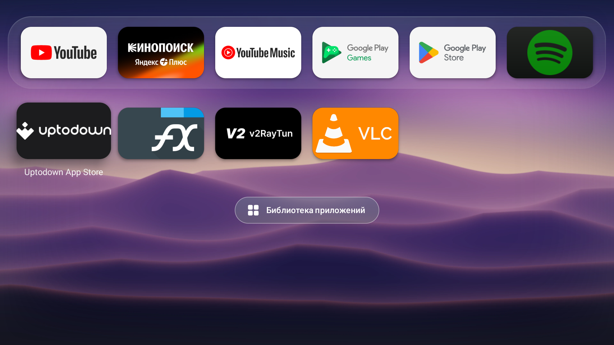
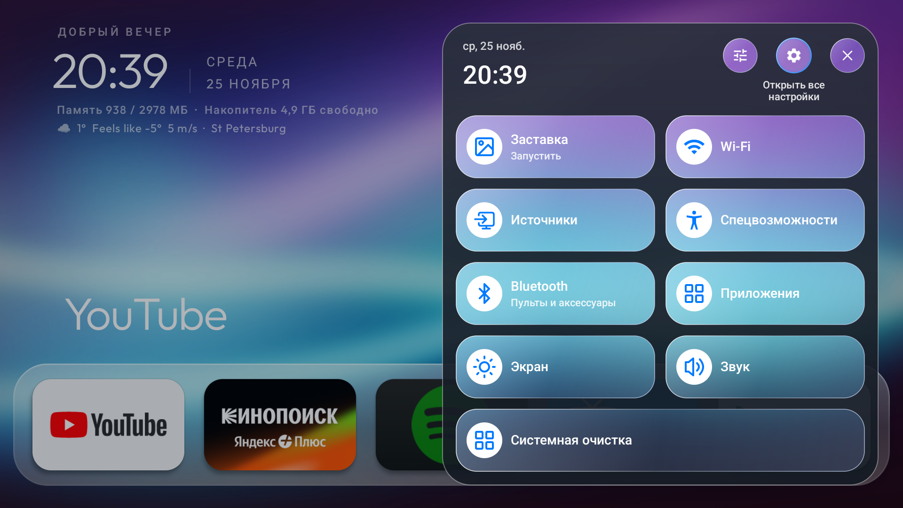
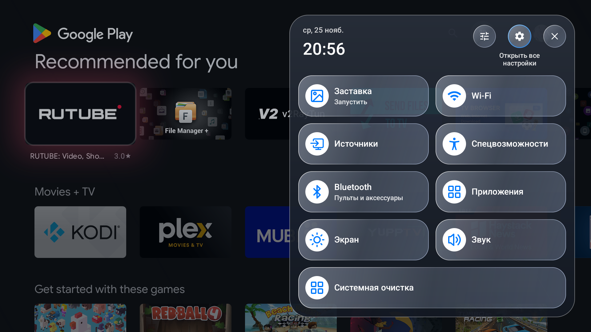
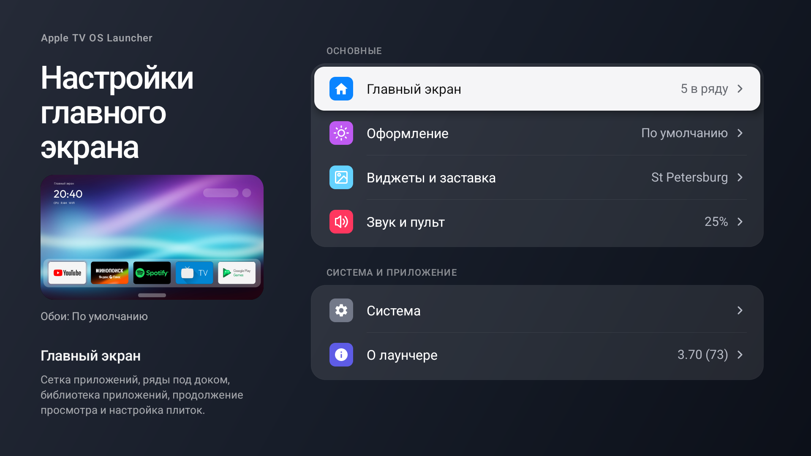
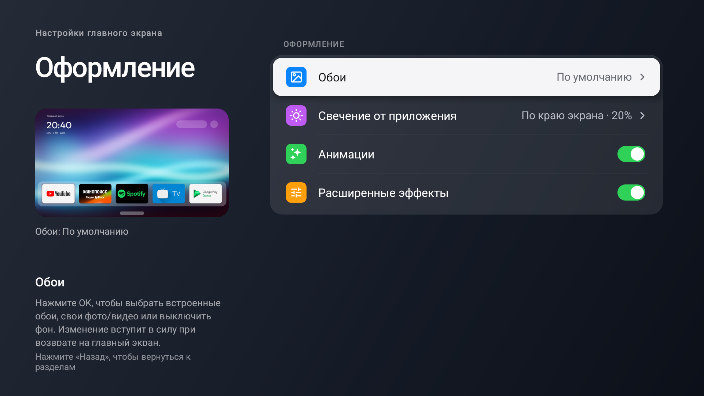
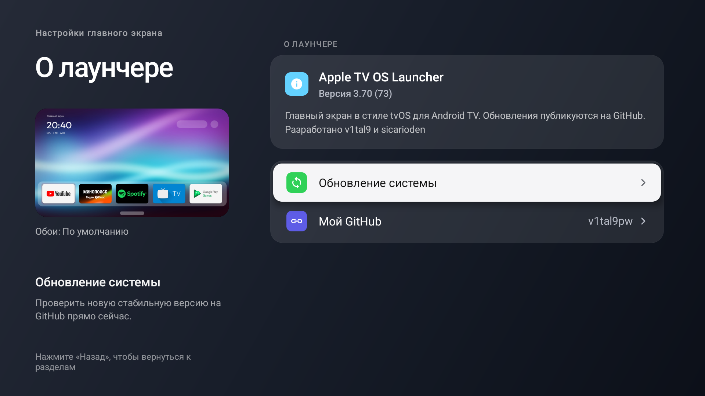
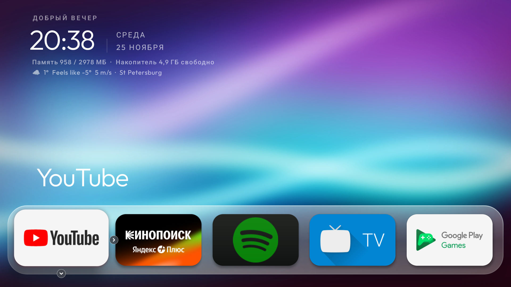

<div align="center">

# v1tal9 TV Launcher

### Лаунчер для Android TV и Google TV в стиле Apple TV

**Стеклянный док · 4K-обои · Плавная панель управления · Системная очистка · Управление с пульта**

[Возможности](#возможности) · [Скриншоты](#скриншоты) · [Управление](#управление) · [Установка](#установка-и-сборка) · [Авторы](#авторы-и-оригинальный-проект)

</div>

---

**v1tal9 TV Launcher** — моя версия [Apple TV OS Launcher](https://github.com/iyashwant/apple-tv-os-launcher) для телевизоров и приставок на Android TV / Google TV.

**Актуальная версия: `3.73 (v76)`** — оптимизирована и проверена для **TCL C6K с Google TV 14** (совместима и с другими Android TV / Google TV устройствами на Android 8.0+). Готовые сборки доступны в [GitHub Releases](https://github.com/v1tal9pw/tv_launcher_apple/releases), подробная история изменений — в [`launcher/RELEASES.md`](launcher/RELEASES.md), а BAT-скрипты настройки и восстановления — в папке [`launcher/`](launcher/).

Цель проекта — быстрый, плавный и минималистичный домашний экран в стиле tvOS, который полностью управляется с пульта и гибко настраивается под себя. Это независимая модификация с сохранением указания на авторов исходного проекта.


## Возможности

- **Главный экран в стиле tvOS:** опущенный полупрозрачный стеклянный док с регулируемой непрозрачностью (`0%–100%` слайдером с шагом `5%`), полностью скрытый до нажатия **«Вниз»** второй ряд приложений, скруглённые карточки (`4–7` в ряду), настраиваемое число рядов под доком, приветствие, часы, дата и системная статистика (ОЗУ и свободная память). Отдельная плитка **«Настройки главного экрана»** с собственной tvOS-иконкой шестерёнки доступна в доке, сетке и библиотеке приложений.
- **4K-обои в стиле Apple и свои фото/видео:**
  - 6 встроенных 4K-обоев (`3840×2160`): *Apple Aurora*, *Monterey Waves*, *Ventura Bloom*, *Sonoma Horizon*, *Sequoia Twilight* и *Tahoe Liquid Glass* с полноцветным декодированием (`ARGB_8888`), автосменой и плавным слайдером затемнения (`0%–100%`, шаг `5%`).
  - Импорт собственных фото (включая мультивыбор) и видеообоев (до Full HD, 30 к/с, 200 МБ; встроенное видео «Вулканическое побережье»), а также **слайд-шоу «Смена изображения» для коллекции «Мои фото»** с интервалом от `1` минуты.
  - Удаление пользовательских обоев прямо в настройках с подтверждением; импортированные фото и видео надёжно хранятся в памяти лаунчера и не сбрасываются после перезагрузки или отключения флешки.
- **Свечение от приложения (App Glow):** выбор стиля (*За доком*, Ambilight-свечение *По краю экрана*, *Горизонт* или полное *Выключение*) и два независимых слайдера `0%–100%` (шаг `5%`) — **интенсивность фонового свечения** и **свечение вокруг выбранной плитки** с живым предпросмотром.
- **Плавная панель управления (Control Center):**
  - Аппаратно ускоренная tvOS-анимация без микро-пролагов с заранее размытым фоном и плавным закрытием по кнопке **«Домой»** — работает как на главном экране, так и поверх сторонних приложений (YouTube, Google Play и др.).
  - Открывается кнопкой **«Шестерёнка»** на пульте (включая код TCL `83`), удержанием **«Домой»** или другой назначенной кнопкой.
  - Возврат по кнопке **«Назад»** из открытых быстрых настроек снова открывает панель управления с фокусом на выбранной плитке.
  - Быстрые плитки: **Заставка**, **Wi-Fi**, **Источники** (стеклянный выбор HDMI / AV / Live TV прямо в оверлее без закрытия активного приложения), **Спецвозможности**, **Bluetooth** (переход в «Пульты и аксессуары»), **Приложения**, **Экран**, **Звук** (родное боковое меню **«Экран и звук»** с параметрами изображения, экрана, звука и аудиовыхода) и полноширинная **Системная очистка**.
  - Изолированный запуск внешних системных настроек телевизора (`FLAG_ACTIVITY_CLEAR_TASK`), чтобы позади бокового меню оставался главный экран лаунчера, а не последнее открытое приложение.
- **Системная очистка через локальный ADB:**
  - Одним нажатием в панели управления (включая работу поверх любых приложений) безопасно закрывает фоновые сторонние и стриминговые медиаприложения и аккуратно освобождает кеш при нехватке места (`pm trim-caches 512M`) без остановки системных сервисов и Play Store, с автоматической защитой лаунчера, активного приложения, активного VPN-соединения, клавиатуры и служб спецвозможностей; показывает статус очистки, число закрытых приложений и освобождённую ОЗУ.
  - Поддержка профиля очистки CleanYourTV для TCL C6K с резервным копированием и восстановлением.
- **Настройки лаунчера по разделам с живым предпросмотром:**
  - Все параметры аккуратно разложены на **6 разделов** в стиле Apple TV (**Главный экран**, **Оформление**, **Виджеты и заставка**, **Звук и пульт**, **Система**, **О лаунчере**) — главный экран настроек полностью помещается без прокрутки, справа отображается сводка текущих значений, а слева — живая миниатюра главного экрана.
  - Обновлённый раздел **«О лаунчере»**: карточка со сведениями о приложении, версии и авторах показана сразу сверху, а при входе фокус автоматически устанавливается на **«Обновление системы»**.
- **Фоновая автопроверка обновлений, красный индикатор и автозапуск:**
  - Автоматическая проверка новых релизов на GitHub раз в 3 часа и ручная проверка со списком изменений.
  - При появлении новой версии загорается красный индикатор (кружочек) на кнопке **«Открыть настройки»** в панели управления (на главном экране и в оверлее), на разделе **«О лаунчере»** и на пункте **«Обновление системы»**.
  - Автоматический возврат на главный экран лаунчера после установки обновления (как при встроенном OTA-обновлении, так и при установке APK вручную, с поддержкой ограничений Android 14+).
- **Надёжные системные звуки навигации (`SoundPool` 48 кГц):**
  - Низколатентный звуковой движок на нативном `SoundPool` (`48 кГц`, 6 потоков) с резервным `AudioTrack` и автовосстановлением после сна телевизора, смены аудиовыхода или возврата из сторонних приложений.
  - Озвучивает переходы и подтверждения везде: на главном экране, в контекстных меню плиток, панели управления, всех разделах и диалогах настроек, «Продолжить просмотр», меню источников, окне очистки и библиотеке приложений.
  - Настраиваемая громкость щелчков (`0%–100%` слайдером с шагом `5%` и живым щелчком на каждом шаге).
- **Папки с автоназванием и библиотека приложений:** при создании папки автоматически предлагается категория по приложению (*Кино и ТВ*, *Музыка*, *Игры*, *Браузеры*, *VPN и сеть*, *Утилиты* и др.); доступно переименование, замена, скрытие приложений, кастомные иконки и удобная библиотека всех установленных приложений.
- **Виджет погоды:** актуальная температура, ощущаемая температура, ветер и город на языке системы с выбором компактного размера шрифта (`8, 10, 12, 14, 16, 20, 24`, по умолчанию `12`).
- **Продолжить просмотр в стиле Apple TV, часы-заставка и настройка пульта:** полноэкранный Full HD арт активного фильма/сериала на весь главный экран (с автоулучшением качества для Кинопоиска / Яндекс CDN, YouTube и TMDB, плавным crossfade и адаптацией стекла панели управления под текущий кадр), плавный возврат наверх по кнопке **«Домой»** из раскрытой сетки приложений, часы в режиме ожидания и гибкое переназначение кнопок пульта (`1× / 2× / 3×` нажатия).

> Некоторые возможности (переключение входов, локальный ADB, Bluetooth-раздел, полка «Продолжить просмотр») зависят от версии Android, прошивки телевизора и установленных приложений.

## Скриншоты

**Сетка приложений и библиотека**



**Панель управления на главном экране**



**Панель управления поверх сторонних приложений**



**Настройки главного экрана по разделам с живым предпросмотром**



**Раздел «Оформление» — 4K-обои и свечение от приложения**



**Раздел «О лаунчере» — карточка сведений и обновление системы**



**Меню действий с приложением**



## Управление

| Действие | Кнопка пульта |
|---|---|
| Перемещение по интерфейсу | Стрелки ↑ ↓ ← → |
| Открыть приложение или пункт | **OK** |
| Открыть меню действий с приложением | **Удержание OK** или **Menu** |
| Открыть / закрыть панель управления | **Шестерёнка (Настройки)** или **Удержание «Домой»** |
| Развернуть сетку приложений и библиотеку | **Вниз** из дока |
| Закрыть меню или вернуться назад | **Назад / Back** |

## Совместимость

- **Платформа:** Android TV / Google TV.
- **Минимальная версия:** Android 8.0 (API 26).
- **Целевое проверенное устройство:** TCL C6K (Google TV 14).
- **Для сборки:** JDK 17, Android SDK Platform 34 и Build Tools 34.0.0.
- **Среда разработки:** Android Studio или Gradle из командной строки.

Интерфейс рассчитан на управление пультом телевизора и оптимизирован для 4K-экранов.

## Установка и сборка

### Готовый APK (GitHub Releases)

Скачай последний `tvhome-*.apk` со страницы [Releases](https://github.com/v1tal9pw/tv_launcher_apple/releases) и установи на телевизор через файловый менеджер или ADB — либо обновись прямо из раздела **Настройки главного экрана → О лаунчере → Обновление системы**.

### Через Android Studio (Windows)

1. Склонируй репозиторий:

   ```powershell
   git clone https://github.com/v1tal9pw/tv_launcher_apple.git
   ```

2. В **Android Studio** выбери **Open** и открой папку `tv_launcher_apple/launcher`.
3. Установи необходимые компоненты SDK и дождись синхронизации Gradle.
4. Открой меню **Build → Build Bundle(s) / APK(s) → Build APK(s)** для отладочной сборки либо собери release через терминал:

   ```powershell
   .\gradlew.bat assembleRelease
   ```

5. Готовый release APK находится по пути:

   ```text
   launcher/app/build/outputs/apk/release/app-release.apk
   ```

   Путь указан от корня репозитория. Если находишься внутри папки `launcher`, используй `app/build/outputs/apk/release/app-release.apk`.

### Установка APK по ADB

На телевизоре включи режим разработчика и отладку по сети или USB (если поддерживается), затем выполни:

```bash
adb connect IP_ТЕЛЕВИЗОРА:ПОРТ
adb install -r launcher/app/build/outputs/apk/release/app-release.apk
```

Команды установки приведены для запуска **из корня репозитория**. При необходимости выбери новый лаунчер в настройках приложения «Главный экран» телевизора или воспользуйся `launcher/tcl-home-handover.bat`.

**Важно:** не отключай и не удаляй штатный лаунчер до проверки работы нового. Для обновления уже установленного APK требуется та же подпись, что у предыдущей версии. Идентификатор пакета по умолчанию: `com.gathin.tvhome`.

## Документация

- [История релизов и изменений](launcher/RELEASES.md)
- [Инструкции для ИИ-агентов](AGENTS.md)
- [Описание возможностей](docs/features.md)
- [Библиотека приложений](docs/app-library.md)
- [Темы и оформление](themes/README.md)
- [Проблемы и решения](docs/TROUBLESHOOTING.md)
- [История интеграции изменений из исходных проектов](docs/upstream-integration.md)

## Авторы и оригинальный проект

**Соавторы этой версии:** [v1tal9](https://github.com/v1tal9pw) и [Денис (sicarioden)](https://github.com/sicarioden).

**Помощь в разработке:** ИИ-ассистенты (OpenAI Codex / Claude / Gemini).

**Оригинальный проект, на котором основана эта версия:** [iyashwant / apple-tv-os-launcher](https://github.com/iyashwant/apple-tv-os-launcher). Спасибо автору за основу интерфейса и проделанную работу.

**Более ранняя основа:** [Gathin23 / CleanYourTV](https://github.com/Gathin23/cleanyourtv) и его участники.

Лицензия: [MIT](LICENSE). Все авторские уведомления и условия исходной лицензии сохраняются. Проект не связан с Apple Inc. и не является официальным продуктом Apple.

---

<div align="center">

Сделано и адаптируется [v1tal9](https://github.com/v1tal9pw) и [Денисом (sicarioden)](https://github.com/sicarioden) · [Репозиторий](https://github.com/v1tal9pw/tv_launcher_apple)

</div>
