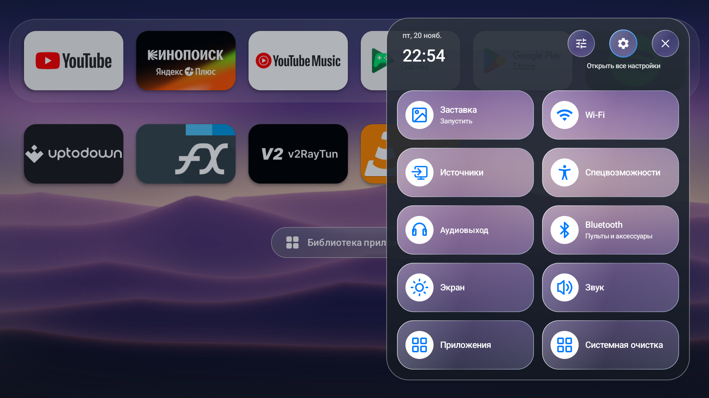

<div align="center">

# v1tal9 TV Launcher

### Лаунчер для Android TV и Google TV в стиле Apple TV

**Стеклянный док · Настраиваемый главный экран · Управление с пульта**

[Возможности](#возможности) · [Скриншоты](#скриншоты) · [Установка](#установка-и-сборка) · [Авторы](#авторы-и-оригинальный-проект)

</div>

---

**v1tal9 TV Launcher** — моя версия [Apple TV OS Launcher](https://github.com/iyashwant/apple-tv-os-launcher) для телевизоров и приставок на Android TV / Google TV.

Цель проекта — удобный минималистичный домашний экран с оформлением в духе tvOS, который можно подстроить под себя. Это независимая модификация с сохранением указания на авторов исходного проекта.


## Возможности

- **Главный экран в стиле tvOS:** полупрозрачный док, скруглённые карточки, анимации и понятное выделение выбранного элемента.
- **Приложения и папки:** избранные приложения в доке, общая сетка приложений, изменение порядка и группировка в папки.
- **Управление с пульта:** навигация крестовиной, открытие приложений кнопкой OK, дополнительные действия по удержанию OK или кнопке Menu.
- **Быстрые настройки:** переход к Bluetooth, звуку, дисплею, заставке, приложениям и системным параметрам телевизора (доступность отдельных пунктов зависит от прошивки).
- **Персонализация:** изменение числа столбцов, оформление карточек и названий приложений, темы, обои, прозрачность дока и анимации.
- **Библиотека приложений:** просмотр установленных приложений и управление их отображением на главном экране.
- **Часы и заставка:** отображение часов в режиме ожидания; дополнительные фоновые и атмосферные эффекты.
- **Продолжить просмотр:** дополнительная полка для совместимых приложений, которые предоставляют сведения о незавершённом просмотре через Android TV.
- **Назначение кнопок пульта:** настройка поддерживаемых физических кнопок; для работы назначений за пределами главного экрана может потребоваться служба специальных возможностей.

> Некоторые возможности зависят от версии Android, прошивки телевизора и установленных приложений. Проект развивается, поэтому работа отдельных функций на конкретных моделях не гарантируется.

## Скриншоты

**Главный экран и приложения**


**Быстрые настройки**


**Настройки внешнего вида и поведения**


**Меню действий с приложением**


**Выбор источника сигнала**



## Управление

| Действие | Кнопка пульта |
|---|---|
| Перемещение по интерфейсу | Стрелки ↑ ↓ ← → |
| Открыть приложение или пункт | **OK** |
| Открыть дополнительные действия | **Удержание OK** или **Menu** |
| Развернуть список приложений | **Вниз** из дока |
| Перейти к верхним элементам | **Вверх** из дока |
| Закрыть меню или вернуться назад | **Назад / Back** |

## Совместимость

- **Платформа:** Android TV / Google TV.
- **Минимальная версия:** Android 8.0 (API 26).
- **Для сборки:** JDK 17, Android SDK Platform 34 и Build Tools 34.0.0.
- **Среда разработки:** Android Studio или Gradle из командной строки.

Интерфейс рассчитан на управление пультом телевизора. Совместимость с конкретными устройствами и производительностью 4K-интерфейса нужно проверять отдельно.

## Установка и сборка

### Через Android Studio (Windows)

1. Склонируй репозиторий:

   ```powershell
   git clone https://github.com/v1tal9pw/tv_launcher_apple.git
   ```

2. В **Android Studio** выбери **Open** и открой папку `tv_launcher_apple/launcher`.
3. Установи необходимые компоненты SDK и дождись синхронизации Gradle.
4. Открой меню **Build → Build Bundle(s) / APK(s) → Build APK(s)** для отладочной сборки либо собери release через терминал:

   ```powershell
   .\gradlew.bat assembleRelease
   ```

5. Готовый release APK находится по пути:

   ```text
   launcher/app/build/outputs/apk/release/app-release.apk
   ```

   Путь указан от корня репозитория. Если находишься внутри папки `launcher`, используй `app/build/outputs/apk/release/app-release.apk`.

### Установка APK по ADB

На телевизоре включи режим разработчика и отладку по сети или USB (если поддерживается), затем выполни:

```bash
adb connect IP_ТЕЛЕВИЗОРА:ПОРТ
adb install -r launcher/app/build/outputs/apk/release/app-release.apk
```

Команды установки приведены для запуска **из корня репозитория**. При необходимости выбери новый лаунчер в настройках приложения «Главный экран» телевизора.

**Важно:** не отключай и не удаляй штатный лаунчер до проверки работы нового. Для обновления уже установленного APK требуется та же подпись, что у предыдущей версии. Идентификатор пакета по умолчанию: `com.gathin.tvhome`.

## Документация

- [Описание возможностей](docs/features.md)
- [Библиотека приложений](docs/app-library.md)
- [Темы и оформление](themes/README.md)
- [Проблемы и решения](docs/TROUBLESHOOTING.md)
- [История интеграции изменений из исходных проектов](docs/upstream-integration.md)

## Авторы и оригинальный проект

**Модификация и развитие этой версии:** [v1tal9](https://github.com/v1tal9pw).

**Оригинальный проект, на котором основана эта версия:** [iyashwant / apple-tv-os-launcher](https://github.com/iyashwant/apple-tv-os-launcher). Спасибо автору за основу интерфейса и проделанную работу.

**Более ранняя основа:** [Gathin23 / CleanYourTV](https://github.com/Gathin23/cleanyourtv) и его участники.

Лицензия: [MIT](LICENSE). Все авторские уведомления и условия исходной лицензии сохраняются. Проект не связан с Apple Inc. и не является официальным продуктом Apple.

---

<div align="center">

Сделано и адаптируется [v1tal9](https://github.com/v1tal9pw) · [Репозиторий](https://github.com/v1tal9pw/tv_launcher_apple)

</div>
